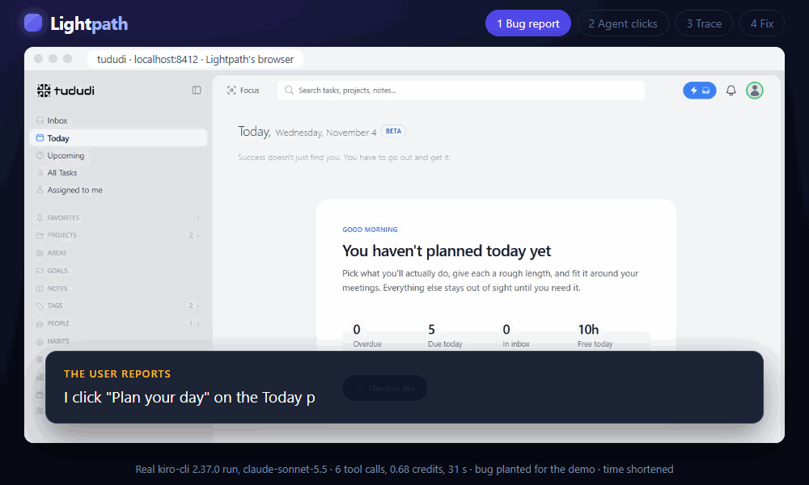

# Lightpath

[](https://www.npmjs.com/package/@lightpath-dev/cli)
[](https://github.com/Unknown-333/Lightpath/actions/workflows/ci.yml)
[](#mcp-tools)
[](#quick-start)
[](LICENSE)

**Show your coding agent the exact lines one click ran.**

Lightpath is an MCP server for React + Node apps. Your agent clicks a button in your running app and gets back the code that click ran, in the browser and on the server, line by line. It reads V8's own coverage, so it shows what ran, not a guess from file names.




## Quick start

In your app's folder (React in the browser, a Node server, a `dev` script in `package.json`):

```sh
npx @lightpath-dev/cli init --agent claude-code   # or: cursor, vscode, kiro
npx @lightpath-dev/cli doctor                     # checks what init wrote
# restart your agent, then tell it the bug: "I click Save and the list doesn't update"
```

That's all. The first time the agent calls a Lightpath tool, Lightpath starts your dev server and its own browser by itself, and stops them when the agent closes.

Needs Node.js 22.12+ and Chrome or Edge.

> **0.1.0 is not on npm yet.** Until it is, `npx` gets 0.0.2, which has no `init`, `run_action` or auto-start ([CHANGELOG](CHANGELOG.md)).

## What your agent gets

This is an agent's `run_action` call on this repo's small example app, `examples/invoices`, from an earlier recorded run with a planted bug, and the start of what came back (cut where it says `…`; the full answer is in [the transcript](docs/media/demo-run/transcript.jsonl)). It is shown here instead of the GIF's tududi trace because it is short enough to read whole:

```
run_action  target: button "Mark as paid"  within: "Kestrel Labs"

Trace t_dw649hdbx0jj: button: Mark as paid
action: click button "Mark as paid" within "Kestrel Labs" (boundary press, settled quiet)
page: http://localhost:5174/
request: POST /api/invoices/INV-2041/pay → 200 (node, 4 ms)

before POST /api/invoices/INV-2041/pay [browser]
  src/api.ts
    payInvoice 31-33 ×1
  src/App.tsx
    App 14-103 ×2 not run: 22-28, 35-42, 96-98
    pay 31-43 ×1 not run: 35-42
  …
POST /api/invoices/INV-2041/pay → 200 [node, 4 ms]
  server/data.ts
    findInvoice 85-87 ×1
    (anonymous) 86 ×1
  server/routes/invoices.ts
    payInvoice 9-20 ×1 not run: 14-19
  server/services/ledger.ts
    getSummary 14-28 ×1 not run: 16-27
    markPaid 38-46 ×1
after the response [browser]
  …
```

Each function that ran is listed with its lines, how often it was called, and the lines inside it that did **not** run. Here `getSummary` ran, but lines 16-27, where the totals are summed, didn't: it returned a cached copy. That's the bug, and the agent said so in its answer.

Every answer is at most 16,000 characters (about 4,000 tokens). When a trace is bigger, the least-used files are left out and the last line says how to see them with `get_trace` ([D-109](decisions.md), checked in `pnpm e2e`).

## MCP tools

| Tool                   | What it does                                                                                     |
| ---------------------- | ------------------------------------------------------------------------------------------------ |
| `run_action`           | Clicks a button or link, or presses Enter or Space, in your app, and returns that click's trace  |
| `run_request`          | Sends one HTTP request to your app on localhost and returns the backend code it ran (no browser) |
| `find_code_for_action` | The latest trace for an action by its label, without acting ("which code handles Checkout?")     |
| `get_trace`            | One file or function of a trace, line by line, with the lines that didn't run marked             |
| `diff_traces`          | Two traces of the same action, before and after a fix: what ran in only one                      |
| `list_traces`          | Recent actions, newest first, with their trace ids                                               |

`run_action` can fill form fields first, for example to sign in. The values it types never appear in any output. The whole tool list is under 4,000 characters, so it costs your agent little context (`packages/mcp/test/output.test.ts`).

## Set up your agent

One command in your project folder. Each writes the agent's MCP config, a `lightpath.config.json` with your dev command, and a short block in `AGENTS.md` (and `CLAUDE.md` if you have one) that tells the agent when to use Lightpath.

| Agent       | Command                                           | Writes                    | Guide                                                    |
| ----------- | ------------------------------------------------- | ------------------------- | -------------------------------------------------------- |
| Claude Code | `npx @lightpath-dev/cli init --agent claude-code` | `.mcp.json`               | [docs/agents/claude-code.md](docs/agents/claude-code.md) |
| Cursor      | `npx @lightpath-dev/cli init --agent cursor`      | `.cursor/mcp.json`        | [docs/agents/cursor.md](docs/agents/cursor.md)           |
| VS Code     | `npx @lightpath-dev/cli init --agent vscode`      | `.vscode/mcp.json`        | [docs/agents/vscode.md](docs/agents/vscode.md)           |
| Kiro        | `npx @lightpath-dev/cli init --agent kiro`        | `.kiro/settings/mcp.json` | [docs/agents/kiro.md](docs/agents/kiro.md)               |

What is tested: CI runs all four `init` commands on Linux, macOS and Windows with no agent installed, starts the server each config names, lists its tools, and runs `doctor` (`scripts/setup-check.mjs`). Only Kiro (kiro-cli 2.37.0) has run Lightpath for real, in the benchmark and the GIF. How Claude Code, Cursor and VS Code pick and call MCP tools is **from their docs**, not tested here.

Other servers in the config file stay. Running init again changes nothing. On Windows, init writes `cmd /c npx …`, which doesn't run on macOS or Linux, so a teammate there runs init again; `doctor` flags the wrong form.

## How it works

```
 Lightpath's browser ──(V8 coverage over DevTools)──┐
       │ click → request + x-lightpath-trace         │
       ▼                                             ▼
 your Node server ──(in-process agent)──────► lightpath daemon ──► MCP (your agent), terminal, VS Code
```

| Part           | How                                                                                                                                                                            |
| -------------- | ------------------------------------------------------------------------------------------------------------------------------------------------------------------------------ |
| Browser        | V8 precise coverage over the Chrome DevTools Protocol. Reading it resets the counters, so a read before and after a click gives exactly that click's code                      |
| Click boundary | A capture `pointerdown` listener pauses the page for the read, before your handlers run ([ADR 0003](docs/adr/0003-click-boundary.md))                                          |
| Agent clicks   | `run_action` acts in the browser Lightpath opened, through Playwright, on 127.0.0.1 with the daemon's token. No debug port is opened ([ADR 0007](docs/adr/0007-run-action.md)) |
| Node backend   | An agent preloaded with `--require` brackets each HTTP request with coverage reads, using `diagnostics_channel`                                                                |
| Joining them   | Requests from the click carry an `x-lightpath-trace` header                                                                                                                    |
| Mapping        | Byte offsets → lines → source maps → your files, in a pure, tested pipeline                                                                                                    |

No code changes to your app. The daemon listens on `127.0.0.1` and needs a token. Nothing leaves your machine. Secrets in URLs, `key=value` pairs, `Bearer` tokens and JWT-like strings become `[redacted]` in every answer, and request and response bodies and headers are never collected ([D-123](decisions.md), `packages/mcp/test/redact.test.ts`, `pnpm e2e`).

More: [docs/ARCHITECTURE.md](docs/ARCHITECTURE.md), [docs/PROTOCOL.md](docs/PROTOCOL.md), [docs/adr](docs/adr).

## Benchmark

**Lightpath did not help the agent fix more bugs, and it cost more.** We ran kiro-cli 2.37.0 (`claude-sonnet-5.5`) on seeded bugs in two apps, with and without Lightpath. Without it, the agent already fixed every visible bug. With it, the agent used more steps and more credits in every set.

| Set                     | Fixed, without | Fixed, with | Credits per run, without → with | Steps per run, without → with |
| ----------------------- | -------------- | ----------- | ------------------------------- | ----------------------------- |
| Shop, 7 bugs            | 21 of 21       | 20 of 21 *  | 0.317 → 0.493                   | 5.00 → 7.10                   |
| tududi, 3 bugs          | 15 of 15       | 15 of 15    | 0.980 → 1.329                   | 9.87 → 13.47                  |
| Shop, 3 held-out bugs   | 9 of 9         | 9 of 9      | 0.339 → 0.434                   | 5.67 → 6.56                   |
| tududi, 2 held-out bugs | 9 of 10        | 6 of 10 *   | 1.116 → 1.333                   | 12.50 → 13.44                 |

\* A flaw in the scoring's void check counts one shop run and one tududi run against `with`; without it, 21 of 21 and 7 of 10. The flaw is logged, not fixed.

Read it with these limits: one agent and one model; [tududi](https://github.com/chrisvel/tududi) has only 3 visible bugs, and all 5 of its fixes are public, so the model may have seen them; 3 runs per bug on the shop, 5 on tududi. With Lightpath set up, the agent called it by itself in 31 of 53 valid runs.

So the claim is only what was measured: your agent can see the exact lines one click ran, browser and server. Methods, every run and the variance: [bench/agent-suite/results/2026-11-03-full-benchmark.md](bench/agent-suite/results/2026-11-03-full-benchmark.md).

## Compared with other tools

As of November 2026 we found no other MCP tool that returns the lines one click ran in both the browser and the backend ([docs/research/competitors.md](docs/research/competitors.md), read 2026-11-01). Other tools are better at other things:

| Tool                                | Better than Lightpath at                                                                               |
| ----------------------------------- | ------------------------------------------------------------------------------------------------------ |
| Chrome DevTools MCP, Playwright MCP | Console, network bodies, screenshots, DOM and performance. Playwright MCP also runs Firefox and WebKit |
| Replay MCP                          | Values at any moment and time travel, from a recording                                                 |
| Sentry, Datadog MCP                 | Production errors and traces across services                                                           |
| React Grab                          | The quickest way to point an agent at one element                                                      |

Lightpath is a development tool. It doesn't watch production.

## Limits

- Chromium browsers only (Chrome or Edge): precise coverage is a DevTools Protocol feature.
- Node backends. A Python agent is a preview and isn't joined into click traces yet.
- `run_action` does click, Enter and Space, with fields filled first. Not hover, drag, file upload, dialogs, popups or iframes ([docs/design/agent-loop.md](docs/design/agent-loop.md), section 15).
- Not traced yet: WebSocket messages (socket.io), Web Workers, Next.js server components, worker threads.
- Overlapping requests in one process can't be told apart; their traces say "overlapped".
- In very large apps (over about 3,000 React components in dev mode), clicks are traced from the mouse release, so `pointerdown` and `mousedown` handlers are left out.
- webpack needs source maps in development (`devtool: 'eval-cheap-module-source-map'`); Lightpath says so when they're missing. Vite needs nothing.
- Service workers are off in Lightpath's browser, so requests stay visible to it. Offline mode and push don't work there.

Found another? [Open an issue](https://github.com/Unknown-333/Lightpath/issues) with your stack and what you clicked.

## Without an agent

`lightpath dev` runs your dev command and opens your app; each click prints its code path in the terminal:

```sh
npx @lightpath-dev/cli dev -- npm run dev
```

```
◆ button: Checkout 335 ms
  → POST /api/orders 201
  ├─ src/Cart.tsx :11-14, 16-19, 21-28, 30-33, 35-44, 46-48, 50 ×4
  ├─ server/routes/orders.ts :11-14, 19-21, 25, 29, 31-33, 38-40
  └─ server/services/pricing.ts :12-19, 21-22, 26-33
```

(From the example shop, cut to 3 of its 8 files.) A [VS Code extension](https://marketplace.visualstudio.com/items?itemName=lightpath-dev.lightpath-vscode) (0.0.1) lights up the lines that ran in your editor and can replay a click file by file.

### Config file

Flags are enough for most apps. To save them, or to hide generated code, put a `lightpath.config.json` next to your `package.json` (`init` writes one):

```json
{
  "$schema": "./node_modules/@lightpath-dev/cli/lightpath.config.schema.json",
  "command": "npm run dev",
  "autoStart": true,
  "ignore": ["src/generated/**", "*.gen.ts"]
}
```

| Key                       | What it does                                                                     |
| ------------------------- | -------------------------------------------------------------------------------- |
| `command`                 | Your dev command. A string runs in a shell; a list runs as is                    |
| `autoStart`               | Lets `lightpath mcp` start `lightpath dev` the first time a tool needs it        |
| `url`                     | Your app's URL, if Lightpath can't find it in the command's output               |
| `webRoot`                 | The folder your dev server serves from, if it isn't this one                     |
| `backend`                 | Remote API origins to link to clicks. Local ones on any port are linked already  |
| `roots`                   | Folders whose files show in traces (default: this one)                           |
| `ignore`                  | Globs for files to leave out of traces                                           |
| `settleMs`, `maxSettleMs` | How long a click waits for quiet (300 ms) and at most (5,000 ms)                 |
| `browser`, `headless`     | `browser: false` traces backend requests only; `headless: true` hides the window |

A flag on the command line wins over the file. Unknown keys are errors, so typos don't pass silently.

## Performance

For development, not production or load tests. Measured on Windows 11 with a Ryzen 7 9700X ([bench/README.md](bench/README.md)):

| What                                                | Cost                     |
| --------------------------------------------------- | ------------------------ |
| Backend request, Express/Fastify/Nest examples      | 4 to 6 ms extra          |
| Backend request, about 50,000 functions             | about 50 ms extra        |
| Click pause, 100 React components                   | 2.4 ms p50, 3.0 ms p99   |
| Click pause, 3,000 React components                 | 7.9 ms p50, 11.3 ms p99  |
| Click pause, Actual Budget (about 35,000 functions) | 15.9 ms p50, 19.8 ms p99 |

## Tested on real apps

| App                                                                               | Stack                                 | Result                                              |
| --------------------------------------------------------------------------------- | ------------------------------------- | --------------------------------------------------- |
| [stepful/fullstack_boilerplate](https://github.com/stepful/fullstack_boilerplate) | React + Vite, Fastify under `ts-node` | Works with no flags                                 |
| [chrisvel/tududi](https://github.com/chrisvel/tududi)                             | React + webpack, Express              | Works once webpack has source maps                  |
| [actualbudget/actual](https://github.com/actualbudget/actual)                     | React 19 + Vite, bundled Express 5    | Works, 263 frontend files on one click              |
| [louislam/uptime-kuma](https://github.com/louislam/uptime-kuma)                   | Vue + Vite, Express + socket.io       | Works for HTTP requests; socket.io messages not yet |

Details: [docs/tested-apps.md](docs/tested-apps.md).

## Try it on the example apps

```sh
git clone https://github.com/Unknown-333/Lightpath.git
cd Lightpath
corepack pnpm install
corepack pnpm build
corepack pnpm --filter invoices lightpath   # the app in the GIF; or: --filter shop
```

## Packages

| Package                                            | What it does                                           |
| -------------------------------------------------- | ------------------------------------------------------ |
| [`@lightpath-dev/cli`](packages/cli)               | `lightpath init`, `mcp`, `dev`, `doctor`               |
| [`@lightpath-dev/mcp`](packages/mcp)               | The MCP tools                                          |
| [`@lightpath-dev/daemon`](packages/daemon)         | Receives coverage, builds traces, runs actions         |
| [`@lightpath-dev/browser`](packages/browser)       | Chrome launcher, click boundary, frontend coverage     |
| [`@lightpath-dev/node-agent`](packages/node-agent) | Runs inside your Node process; no dependencies         |
| [`@lightpath-dev/core`](packages/core)             | Coverage ranges to source lines; pure and fully tested |
| [`@lightpath-dev/protocol`](packages/protocol)     | Message schemas and the daemon client                  |
| [`lightpath-vscode`](extensions/vscode)            | Editor highlights and replay (0.0.1)                   |
| [`lightpath-agent`](agents/python) (PyPI)          | Python agent with WSGI and ASGI middleware (preview)   |

## Roadmap

After 0.1.0, in this order: Next.js, WebSocket messages (socket.io), then Python backends (FastAPI) in the same trace as the React frontend ([docs/design/agent-loop.md](docs/design/agent-loop.md)). Milestones so far: [docs/ROADMAP.md](docs/ROADMAP.md). Changes: [CHANGELOG.md](CHANGELOG.md).

## Contributing

Issues and pull requests are welcome. See [CONTRIBUTING.md](CONTRIBUTING.md); `corepack pnpm check` runs what CI runs. Good first issues are labelled [`good first issue`](https://github.com/Unknown-333/Lightpath/labels/good%20first%20issue).

## License

[MIT](LICENSE)
