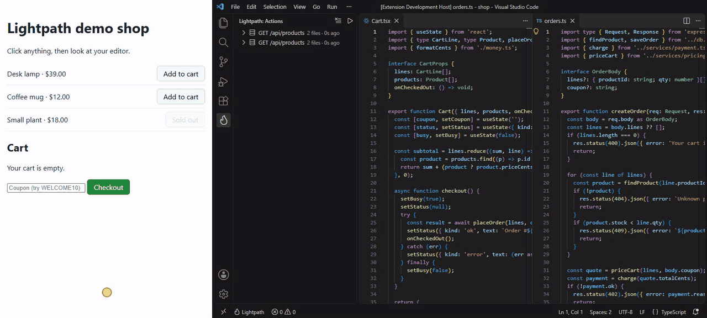

# Lightpath

Click anything in your running app and watch the code that ran light up in your editor: frontend and backend, line by line, brighter the more times it ran.



```
◆ button: Checkout 419 ms
  → POST /api/orders 201
  ├─ src/api.ts :25-32, 35-36
  ├─ src/Cart.tsx :11-14, 16-19, 21-28, 30-33, 35-40, 42-44, 46 ×4
  ├─ server/routes/orders.ts :11-14, 19-21, 25, 29, 31-33, 38-40
  ├─ server/services/pricing.ts :12-19, 21-22, 26-28
  └─ server/services/payment.ts :6-7, 10-12
```

That's real output from the example shop. The empty-cart branch in `orders.ts` didn't run, so it isn't listed.

> **Status: pre-alpha.** The full path works on the example shop (React + Vite + Express). It hasn't been tried on many real apps yet. See [the roadmap](docs/ROADMAP.md).

## Why

You open an unfamiliar or AI-written codebase and spend an hour working out which of 400 files handle one button. Coverage tools only show what your tests ran. Tracing tools show whole requests, not lines, and need setup in your code. Lightpath answers "what ran when I clicked this?" with no code changes.

## Quick start

Requires Node.js 22.12+ and Chrome or Edge.

```sh
npx @lightpath-dev/cli dev -- npm run dev
```

Lightpath starts your dev command, waits for its URL, and opens your app in a browser. Click something. The code path prints in your terminal, and with the VS Code extension it lights up in your editor.

Try it on the example app from this repo:

```sh
corepack pnpm install
corepack pnpm build
corepack pnpm --filter shop lightpath
```

## How it works

| Part           | Technique                                                                                                                                                                   |
| -------------- | --------------------------------------------------------------------------------------------------------------------------------------------------------------------------- |
| Browser        | V8 precise coverage over the Chrome DevTools Protocol. Reading coverage resets V8's counters, so a read just before a click and one after it give exactly that click's code |
| Click boundary | A capture `pointerdown` listener pauses the page for about 5 ms before your handlers run ([ADR 0003](docs/adr/0003-click-boundary.md))                                      |
| Node backend   | An in-process agent preloaded with `--require` brackets each HTTP request with coverage reads, using `diagnostics_channel`                                                  |
| Python backend | `sys.monitoring` with per-line `DISABLE` and `restart_events()`: one callback per line per request                                                                          |
| Correlation    | Requests from the click carry an `x-lightpath-trace` header                                                                                                                 |
| Mapping        | Byte offsets → lines → source maps → your files, in a pure, tested pipeline                                                                                                 |

Everything stays on your machine. The daemon listens on `127.0.0.1` only and requires a token.

Read [docs/ARCHITECTURE.md](docs/ARCHITECTURE.md) for the full design, [docs/PROTOCOL.md](docs/PROTOCOL.md) for the wire format, and [docs/adr](docs/adr) for the decisions and what was measured.

## Packages

| Package                                            | What it does                                                      |
| -------------------------------------------------- | ----------------------------------------------------------------- |
| [`@lightpath-dev/cli`](packages/cli)               | `lightpath dev`, `lightpath mcp`, `lightpath doctor`              |
| [`@lightpath-dev/core`](packages/core)             | Coverage ranges to source lines; pure and fully tested            |
| [`@lightpath-dev/daemon`](packages/daemon)         | Receives coverage, builds traces, serves clients                  |
| [`@lightpath-dev/browser`](packages/browser)       | Chrome launcher, click boundary, frontend coverage                |
| [`@lightpath-dev/node-agent`](packages/node-agent) | Runs inside your Node process; no dependencies                    |
| [`@lightpath-dev/mcp`](packages/mcp)               | MCP tools so coding agents can ask "which code handles Checkout?" |
| [`@lightpath-dev/protocol`](packages/protocol)     | Message schemas and the daemon client                             |
| [`lightpath-vscode`](extensions/vscode)            | Heat highlights, hit counts, action list, replay                  |
| [`lightpath-agent`](agents/python) (PyPI)          | Python agent with WSGI and ASGI middleware                        |

## Known limits

- Chromium-based browsers only (precise coverage is a DevTools Protocol feature).
- The app runs slower while Lightpath is on. Each backend request pays for two coverage reads: 4 to 6 ms on the Express, Fastify, and Nest examples, about 50 ms in an app with 50,000 functions ([bench/README.md](bench/README.md)). Fine for development, not for load tests.
- Overlapping requests in one process can't be separated; their traces are marked "overlapped".
- In very large apps (over about 3,000 React components in dev mode), clicks are traced from the mouse release, so `pointerdown` and `mousedown` handlers aren't included ([bench/README.md](bench/README.md)).
- Next.js server components and worker threads aren't supported yet.
- webpack apps need source maps in development. webpack's default dev setting (`devtool: 'eval'`) has none, so frontend files can't be shown; Lightpath says so and suggests `devtool: 'eval-cheap-module-source-map'`. Vite needs nothing.
- Service workers are turned off in the browser Lightpath opens, so requests stay visible to it. Offline mode and push notifications won't work there.
- Code running in Web Workers isn't traced yet.
- Backend code is traced per HTTP request. Messages over WebSockets (socket.io and similar) don't open a backend trace yet.

[docs/tested-apps.md](docs/tested-apps.md) lists the real open-source apps Lightpath has been run on, and what each one found.

## Contributing

See [CONTRIBUTING.md](CONTRIBUTING.md). `corepack pnpm check` runs everything CI runs.

## License

[MIT](LICENSE)
