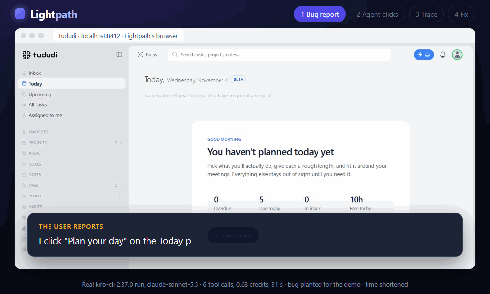

# @lightpath-dev/cli

[](https://www.npmjs.com/package/@lightpath-dev/cli)
[](https://github.com/Unknown-333/Lightpath/actions/workflows/ci.yml)
[](https://github.com/Unknown-333/Lightpath/blob/main/LICENSE)

**Show your coding agent the exact lines one click ran.**

Lightpath is an MCP server for React + Node apps. Your agent clicks a button in your running app and gets back the code that click ran, in the browser and on the server, line by line. It reads V8's own coverage, so it shows what ran, not a guess from file names.



A real kiro-cli 2.37.0 run (claude-sonnet-5.5, 6 tool calls, 0.68 credits) on [tududi](https://github.com/chrisvel/tududi), an open-source task manager, run locally. Screens from tududi (MIT, © Tududi Developers), recoloured to Lightpath's palette. The bug was planted for the demo; tududi doesn't have it. Time is shortened. [How it was made](https://github.com/Unknown-333/Lightpath/tree/main/docs/media/tududi-run).

## Quick start

In your app's folder (React in the browser, a Node server, a `dev` script in `package.json`):

```sh
npx @lightpath-dev/cli init --agent claude-code   # or: cursor, vscode, kiro
npx @lightpath-dev/cli doctor                     # checks what init wrote
# restart your agent, then tell it the bug: "I click Save and the list doesn't update"
```

The first time the agent calls a Lightpath tool, Lightpath starts your dev server and its own browser by itself, and stops them when the agent closes. Needs Node.js 22.12+ and Chrome or Edge.

Without an agent, `npx @lightpath-dev/cli dev -- npm run dev` opens your app and prints each click's code path in the terminal.

## Commands

| Command                                                      | What it does                                                                                                          |
| ------------------------------------------------------------ | --------------------------------------------------------------------------------------------------------------------- |
| `lightpath init --agent <claude-code\|cursor\|vscode\|kiro>` | Writes that agent's MCP config, `lightpath.config.json` and the `AGENTS.md` block                                     |
| `lightpath mcp`                                              | MCP server over stdio: `run_action`, `run_request`, `find_code_for_action`, `get_trace`, `diff_traces`, `list_traces` |
| `lightpath dev`                                              | Runs your dev command with Lightpath and opens your app                                                               |
| `lightpath doctor`                                           | Checks Node, the browser, the agent, your config file and what init wrote                                             |

Everything stays on your machine: the daemon listens on `127.0.0.1` only and needs a token, and secrets are redacted in every tool answer.

## More

- [What your agent gets](https://github.com/Unknown-333/Lightpath#what-your-agent-gets) and [the MCP tools](https://github.com/Unknown-333/Lightpath#mcp-tools).
- [Set up per agent](https://github.com/Unknown-333/Lightpath#set-up-your-agent) and [how it works](https://github.com/Unknown-333/Lightpath#how-it-works).
- [The benchmark](https://github.com/Unknown-333/Lightpath#benchmark): Lightpath didn't raise the fix rate, and the README says so.
- [Limits](https://github.com/Unknown-333/Lightpath#limits) and [real apps it was tested on](https://github.com/Unknown-333/Lightpath#tested-on-real-apps).
- [Issues](https://github.com/Unknown-333/Lightpath/issues) and the [changelog](https://github.com/Unknown-333/Lightpath/blob/main/CHANGELOG.md).

MIT licensed.
